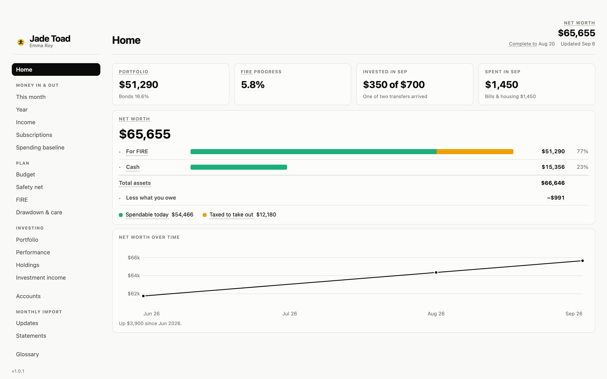

<b>English</b> · <a href="README.zh.md">中文</a>

  

# Jade Toad

**Your money on one page, for working toward financial independence in Canada.**

**[Open the live demo →](https://lydiablllue.github.io/jade-toad/)** a made-up owner's page,
nothing to install.

Once a month you drop your bank statements into a folder and say *"update dashboards"*. Claude
Code reads them, checks that every statement adds up, files every purchase and rebuilds one HTML
page: what you spent, what you own, how far you are from FIRE. No bank login, no server.

## What you need

| | |
|---|---|
| **Claude plan** | Pro, Max, Team or Enterprise. The free plan does not include Claude Code. Nothing else to pay for — **or no plan at all**: see *Without Claude* below |
| **Claude desktop app** | On a **Mac or Windows** computer, using its **Code** tab, not Chat. Claude Code comes with it |
| **Python 3 and pypdf** | Setup checks for them and gives you the one command if one is missing |
| **Your statements** | Last month's PDFs. A single credit card is enough to start |
| **A screen** | The page needs a window at least 800px wide; a phone shows screenshots only |

**Banks.** RBC and BMO statements and Wealthsimple exports are read by a local parser. For any
other bank, download your transactions as **OFX or QFX** (the *Money* or *Quicken* choice in
online banking): they carry the bank's own balance, so every download checks itself. Read the same
way for any bank, and confirmed on a real BMO one. A bank that offers only a spreadsheet (CSV)
works too, with its balance read off the app once a month. Anything else, Claude reads by hand:
slower, and it means Claude sees it. Bank by bank and broker by broker: **[Supported banks and brokers](docs/banks.md)**.

**Built for Canada.** Canadian dollars, TFSA / RRSP / FHSA, CPP and OAS. Accounts abroad count in
net worth.

## Get started

Twenty to thirty minutes for one bank and a broker; add five to ten for each further bank. The
slow part is downloading last month's files from each bank's website (an OFX download covers
every account at once); the questions take five to eight minutes, most answers pre-filled; the
build and the first import take a second; then five to ten minutes of saying which category
each new merchant is.

1. **Install the [Claude desktop app](https://claude.com/download)** and sign in.
2. **Download this folder** (*Code → Download ZIP*) and unzip it anywhere on your computer.
3. **Open the app's Code tab and choose that folder.**
4. **Drop last month's files into `inbox/`**, filenames untouched.
5. **Say "set this up".** It reads your files, drafts your accounts and plan, and asks only what
   the files cannot say. Skip a question and it shows *Not set*, never a made-up number.

## Each month

About ten minutes: the downloads, then two or three minutes of questions. Download the month's
statements into `inbox/` and say **"update dashboards"**. You get a short
report and any questions a program cannot answer, like a merchant it has not seen. In the app
(below) the same month is the panel's five steps.

## Without Claude

There is a second way in that needs no Claude plan. **Jade Toad.app** — a disk image for macOS
on the releases page, or `python3 app.py` in this folder with Python 3 and pypdf installed —
opens your folder in your browser. The first launch asks where your folder is, or makes one and
walks you through the setup in six screens; every month after that, a panel of five steps: get
this month's files, put them here, import, answer a few questions, done. English or Chinese,
switched in the header. It runs the very code Claude Code runs, on your computer only, and the
same checks hold both doors to the same result. The build is not signed yet, so the first
launch on a Mac is right-click → *Open*.

A model is optional and **off by default**. Turned on in the panel's settings — with your own
key to an OpenAI-compatible service or Anthropic, or Ollama on this computer — it is asked one
thing only: which category a merchant none of the maps know belongs to. It receives the
merchant string and the fifteen category names, nothing else, and its answer is a suggestion
you confirm, never the filing. Every exchange is logged in your folder.

Claude Code stays the other door: the chat, a statement no parser reads, the setup questions
the screens do not cover (anything held abroad, a loan to a friend, your investing buckets).

## Why you can trust it

**Your data**

- **It stays in the folder on your computer**: plain CSV and JSON, and one HTML page. No server,
  no bank login. Back the folder up; there is no other copy.
- **A statement a parser reads never goes to Anthropic.** What Claude does read is the import's
  summary, a merchant it has not seen, and your answers, the way anything you say in Claude Code does.
- **It stays out of git**: setup keeps your data out of commits, and a guard refuses one that would carry it.

**Your numbers**

- **Every statement has to add up before it is let in**: the rows against the statement's own
  totals, every balance against the one before it. One that does not is refused, and you are
  told why.
- **A number that does not reconcile is not shown.** The page says what is missing instead of
  guessing, and a question you skipped reads *Not set*, never a made-up figure.
- **The checks are tested too**: a selftest breaks a copy of the data on purpose, in every way
  listed below, and fails if any check stays quiet.

**The people behind it**

- **Made by one person, for their own money in Canada and back home**, used on their own
  statements every month. Every change runs on that real data before it is released.
- **Open source** (MIT): every line that touches your money can be read.
- **A problem** goes in an issue, without your statements or numbers ([CONTRIBUTING.md](CONTRIBUTING.md));
  **a privacy problem** goes privately ([SECURITY.md](SECURITY.md)).

## More

- **[How it works](docs/how-it-works.md)**: every page, the monthly run, the folder, and the
  checkers that keep the numbers honest.
<!-- LINT:FAULTS n=65 -->
  Four checkers hold every figure to its source; a selftest plants 65 faults to prove they still catch them.
- **[Supported banks and brokers](docs/banks.md)**: which to use, which banks' files are read, which are confirmed on a real
  one, and how to download each.
- **[Roadmap](ROADMAP.md)** and **[Changelog](CHANGELOG.md)**.

<!-- LINT:NAV main=18/4 minwidth=800 -->
The page is 18 pages in 4 sidebar groups —
Home · Accounts · Money in & out · Plan · Investing · Monthly import · Glossary
— desktop only, at least 800px wide.

MIT licence: see [`LICENSE`](LICENSE).
