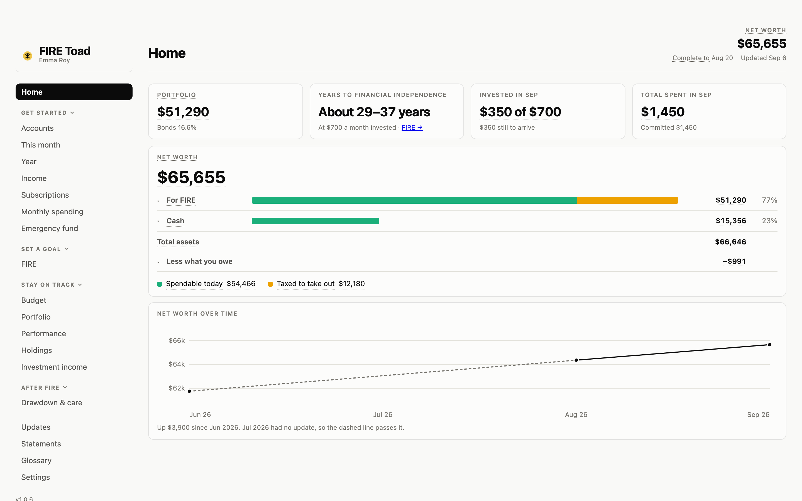
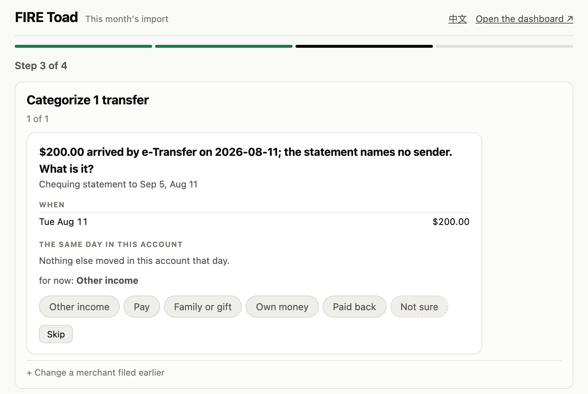
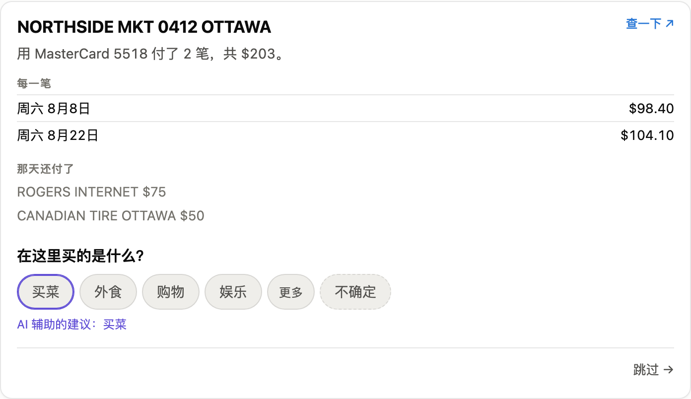
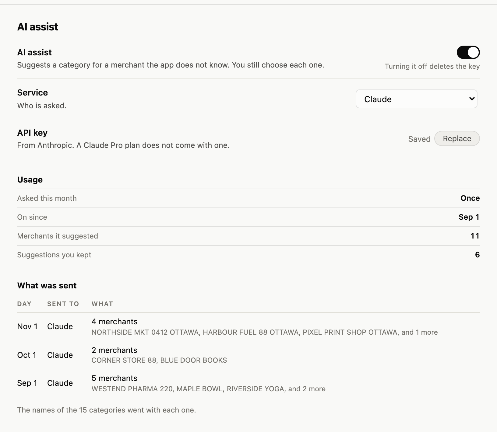

<a href="README.md">English</a> · <b>中文</b>

  

# FIRE Toad · FIRE蛙

**你的钱，一页看完。给在加拿大追求财务自由的人。**

**[打开在线 demo →](https://firetoad.app/dashboard.html)** Emma 的钱，一位虚构的、住在渥太华的 32 岁上班族。什么都不用装。

每个月把银行对账单丢进一个文件夹。工具读取它们，核对每份对账单是否对平，给每笔消费归类，再生成
一个 HTML 页面：花了多少、有多少、离 FIRE 还有多远。不用登录银行，没有服务器，不用注册任何账号。

## 两种用法，选一种

| | **应用**——不需要 Claude 会员 | **Claude Code** |
|---|---|---|
| 是什么 | Mac 上的 `FIRE Toad.app`：你的文件夹在浏览器里打开——建账是六屏向导，每月是四步面板，中英文可切 | 同一个文件夹，在 Claude 桌面应用的对话里操作 |
| 需要 | 一台 Mac 和对应的安装包：[Apple 芯片](https://github.com/lydiablllue/firetoad/releases/latest/download/FIRE-Toad.dmg)（macOS 11 及以上），或 [Intel 芯片](https://github.com/lydiablllue/firetoad/releases/latest/download/FIRE-Toad-Intel.dmg)（macOS 10.15 及以上）（已签名并经 Apple 公证：双击就能打开——[安装说明](docs/zh/install.md)） | 含 Claude Code 的会员（Pro、Max、Team 或 Enterprise）、Claude 桌面应用、Python 3 |
| 适合 | 银行是工具能读的（RBC、BMO，或任何银行的 OFX 下载），券商是 Wealthsimple | 解析器读不了的对账单、要配列的银行 CSV、境外账户、借给朋友的钱、想用说的 |

两边跑的是同一套代码，只在你自己的电脑上，同一套检查保证结果一样。先用一种，另一种随时都在。

## AI 辅助——可选

每个月，app 只有一类事非问你不可：一家它从没见过的商户。打开 **AI 辅助**，这些商户每个都会带一个建议的类别：
卡片上第一个按钮，标明是 AI 辅助的建议。选哪个还是你定：不会替你归类，也没有「全部接受」。

| | |
|---|---|
| **用哪家 AI** | Claude、ChatGPT 或 DeepSeek，用你自己的 API key；或者 Mac 上已经装好、开着的 Ollama。你只选名字、贴 key，不填网址和模型名 |
| **花多少钱** | FIRE蛙不收钱。收钱的是你选的那家 AI 公司：先在它那里充值（Claude Pro、ChatGPT Plus 这类聊天订阅不包括），FIRE蛙每问一次，就从你充的钱里扣一点，按来回的字数算，单价由那家公司定。一个月只在导入时问一次。Ollama 免费 |
| **发出去什么** | 对账单上印的商户名，加上 15 个类别名。从不发金额、日期和账户。用 Ollama 时什么都不离开你的 Mac |
| **多久一次** | 每月一次，在导入的时候：一个请求，带上这个月新出现的商户，最多 50 个。答过的商户不会再发 |
| **你能查什么** | 设置 → AI 辅助：问过几次、它的建议你收下了几个、发过哪些商户 |
| **关掉** | 默认就是关的。关掉时 key 一起删掉 |

  
  

## 你需要什么

| | |
|---|---|
| **两种用法之一** | 应用（一台 Mac），或者 Claude 会员加 Mac/Windows 上的 Claude 桌面应用——见上表。除此之外不用再付费 |
| **Python 3 和 pypdf** | 应用里已经带了。用 Claude Code 的话，setup 会检查，缺什么就给你一条安装命令 |
| **你的对账单** | 上个月的 PDF。只有一张信用卡也能开始 |
| **屏幕** | 页面要求窗口至少 800px 宽；手机上只能看截图 |

**银行。** RBC、BMO 的对账单和 Wealthsimple 的导出由本地解析器读取。其他银行，在网银里把交易下载成
**OFX 或 QFX**（下载选项里的 *Money* 或 *Quicken*）：文件里带着银行给的余额，每次下载都能自己核对。
任何银行都用同一种方式读，已用一份真实的 BMO 下载确认过。只提供表格（CSV）的银行也能用，每月从 app 上
读一次余额。其他格式由 Claude 逐份手读：更慢，而且 Claude 会看到内容。逐家银行和券商的情况见 **[支持的银行和券商](docs/zh/banks.md)**。

**按加拿大设计。** 加元、TFSA / RRSP / FHSA、CPP 和 OAS。国内账户也计入净资产。

## 开始

一家银行加一家券商约 20–30 分钟，每多一家银行加 5–10 分钟。最花时间的是去银行网站下载上个月的文件
（OFX 一次下载包含全部账户）；回答问题 5–8 分钟，多数已经预填；生成和首次导入 1 秒；然后 5–10 分钟
给新商户归类。

**用应用**

1. **[下载 FIRE Toad](https://github.com/lydiablllue/firetoad/releases/latest/download/FIRE-Toad.dmg)**（[Intel 芯片的 Mac](https://github.com/lydiablllue/firetoad/releases/latest/download/FIRE-Toad-Intel.dmg)），打开磁盘映像，双击里面的应用：它会自动装进"应用程序"并打开。安装包已签名并经 Apple 公证；
   macOS 会问一次是否打开从互联网下载的应用，点「打开」（[安装说明](docs/zh/install.md)）。
2. **点「新建文件夹」**：它会替你建在「文稿」里。浏览器会打开建账向导。
3. **把上个月的文件拖到第二屏**，不要改文件名。
4. **走完几屏**——你的名字、每个账户是干什么的、这个月的收支（文件里能看出的已填好）、一个关于 FIRE 的
   问题、你的导入日——按「开始生成」。跳过的问题会显示 *Not set*，绝不会填一个编造的数字。

**用 Claude Code**

1. **安装 [Claude 桌面应用](https://claude.com/download)** 并登录。
2. **下载这个文件夹**（*Code → Download ZIP*），解压到电脑上任意位置。
3. **打开应用的 Code 标签页，选择这个文件夹。**
4. **把上个月的文件放进 `inbox/`**，不要改文件名。
5. **说"set this up"。** 它会读取文件，起草你的账户和计划，只问文件里看不出来的事。

## 每个月

大约十分钟：下载文件，再回答两三分钟的问题。把当月对账单下载到 `inbox/`，说 **"更新看板"**。你会收到一份简短的报告，以及程序决定不了的问题，
比如一个没见过的商户。在应用里（见下节），同一个月就是面板上的四步。

## 应用，再说细一点

**FIRE Toad.app**——[磁盘映像](https://github.com/lydiablllue/firetoad/releases/latest/download/FIRE-Toad.dmg)，或者装好 Python 3 和 pypdf 后在这个文件夹里运行
`python3 app.py`——会在浏览器里打开你的文件夹。第一次启动问你文件夹在哪，或者新建一个并用六屏向导
完成建账；之后每个月是一个四步面板，一次一步：拿到这个月的文件、导入、给剩下的归类、完成。每答一条就
存一条，可以随时停下再回来；归错类的商户在问题下面的列表里改。中英文可在页眉切换。Mac 安装包已签名并经公证，
[双击就能打开](docs/zh/install.md)；Windows 还没有安装包（`python3 app.py` 可以用）。

AI 辅助（见上面）在看板的设置里打开；有它帮得上的商户时，面板会问你一次。

Claude Code 仍是另一扇门：对话、解析器读不了的对账单、向导没覆盖的建账问题（境外账户、借给朋友的钱、
持仓分组）。

## 为什么可以放心用

**你的数据**

- **留在你电脑上的文件夹里**：普通的 CSV 和 JSON，加一个 HTML 页面。没有服务器，不登录银行。请自己备份这个文件夹，别处没有副本。
- **解析器读成功的对账单不会发给 Anthropic。** Claude 会读到的是导入摘要、没见过的商户和你的回答，和你在 Claude Code 里说的任何话一样。
- **不会进 git**：setup 会把你的数据排除在提交之外，还有一道守卫拦住会带上它的提交。

- **AI 辅助默认关着，你不开它不会开。** 开了也只看到商户名和十五个类别名，别的什么都没有。用 Claude、
  ChatGPT 或 DeepSeek 时这些会离开你的电脑，那家服务怎么存由它的条款决定；设置里列着发过的每一个。
  用 Ollama 时什么都不发出去。

**你的数字**

- **每份对账单都要先对平才收进来**：逐行加起来要等于对账单自己印的合计，每个余额要接得上前一个。对不上的会被拒，并告诉你原因。
- **对不上的数字不显示**：页面会说缺了什么，不会猜；setup 里跳过的问题显示 *Not set*，绝不填一个编出来的数。
- **检查本身也被检验**：selftest 会故意把一份数据副本弄坏，用下面列出的每一种方式，只要有一个检查没报警就算失败。

**做这个工具的人**

- **一个人做的，用来管自己在加拿大和国内的钱**，每个月都用自己的真实对账单在用。每次改动都先在这份真实数据上跑过，才发布。
- **开源**（MIT）：每一行碰到你钱的代码都看得到。
- **遇到问题**开 issue，不要附对账单或真实数字（[CONTRIBUTING.md](CONTRIBUTING.md)）；**隐私问题**私下报告（[SECURITY.md](SECURITY.md)）。

## 更多

- **[工作原理](docs/zh/how-it-works.md)**：每一页、每月流程、文件夹结构，以及保证数字可信的检查器。
<!-- LINT:FAULTS n=71 -->
  四个检查器让每个数字都对得上来源；selftest 埋下 71 个问题，证明它们还抓得到。
- **[安装应用](docs/zh/install.md)**：下载、第一次打开、macOS 仍然拦着时怎么办。
- **[支持的银行和券商](docs/zh/banks.md)**：能读哪些银行、券商的哪些文件、该用哪种、哪些已用真实文件确认、每种怎么下载。
- **[发布路线图](RELEASE-ROADMAP.md)** 和 **[更新记录](CHANGELOG.md)**。

<!-- LINT:NAV main=18/4 minwidth=800 -->
页面共 18 页、4 个侧栏分组 ——
Home · Get started · Set a goal · Stay on track · After FIRE · Updates · Statements · Glossary · Settings
—— 仅桌面端，至少 800px 宽。

MIT 许可：见 [`LICENSE`](LICENSE)。
