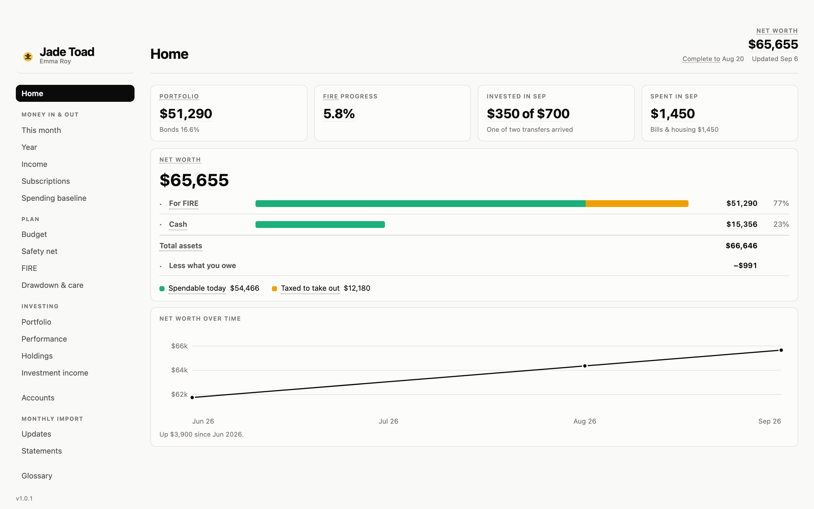

<a href="README.md">English</a> · <b>中文</b>

  

# Jade Toad · 玉蟾

**你的钱，一页看完。给在加拿大追求财务自由的人。**

**[打开在线 demo →](https://lydiablllue.github.io/jade-toad/)** 一位虚构用户的页面，什么都不用装。

每个月把银行对账单丢进一个文件夹，说一句 *"更新仪表盘"*。Claude Code 读取它们，核对每份对账单
是否对平，给每笔消费归类，再生成一个 HTML 页面：花了多少、有多少、离 FIRE 还有多远。不用登录银行，
也没有服务器。

## 你需要什么

| | |
|---|---|
| **Claude 会员** | Pro、Max、Team 或 Enterprise。免费版不含 Claude Code。除此之外不用再付费 |
| **Claude 桌面应用** | 装在 **Mac 或 Windows** 电脑上，用里面的 **Code** 标签页，不是 Chat。Claude Code 已包含在内 |
| **Python 3 和 pypdf** | setup 会检查，缺什么就给你一条安装命令 |
| **你的对账单** | 上个月的 PDF。只有一张信用卡也能开始 |
| **屏幕** | 页面要求窗口至少 800px 宽；手机上只能看截图 |

**银行。** RBC、BMO 的对账单和 Wealthsimple 的导出由本地解析器读取。其他银行，在网银里把交易下载成
**OFX 或 QFX**（下载选项里的 *Money* 或 *Quicken*）：文件里带着银行给的余额，每次下载都能自己核对。
任何银行都用同一种方式读，已用一份真实的 BMO 下载确认过。只提供表格（CSV）的银行也能用，每月从 app 上
读一次余额。其他格式由 Claude 逐份手读：更慢，而且 Claude 会看到内容。逐家银行和券商的情况见 **[支持的银行和券商](docs/zh/banks.md)**。

**按加拿大设计。** 加元、TFSA / RRSP / FHSA、CPP 和 OAS。国内账户也计入净资产。

## 开始

大约二十分钟。

1. **安装 [Claude 桌面应用](https://claude.com/download)** 并登录。
2. **下载这个文件夹**（*Code → Download ZIP*），解压到电脑上任意位置。
3. **打开应用的 Code 标签页，选择这个文件夹。**
4. **把上个月的文件放进 `inbox/`**，不要改文件名。
5. **说"set this up"。** 它会读取文件，起草你的账户和计划，只问文件里看不出来的事。跳过的问题会显示
   *Not set*，绝不会填一个编造的数字。

## 每个月

把当月对账单下载到 `inbox/`，说 **"更新仪表盘"**。你会收到一份简短的报告，以及程序决定不了的问题，
比如一个没见过的商户。

## 为什么可以放心用

**你的数据**

- **留在你电脑上的文件夹里**：普通的 CSV 和 JSON，加一个 HTML 页面。没有服务器，不登录银行。请自己备份这个文件夹，别处没有副本。
- **解析器读成功的对账单不会发给 Anthropic。** Claude 会读到的是导入摘要、没见过的商户和你的回答，和你在 Claude Code 里说的任何话一样。
- **不会进 git**：setup 会把你的数据排除在提交之外，还有一道守卫拦住会带上它的提交。

**你的数字**

- **每份对账单都要先对平才收进来**：逐行加起来要等于对账单自己印的合计，每个余额要接得上前一个。对不上的会被拒，并告诉你原因。
- **对不上的数字不显示**：页面会说缺了什么，不会猜；setup 里跳过的问题显示 *Not set*，绝不填一个编出来的数。
- **检查本身也被检验**：selftest 会故意把一份数据副本弄坏，用下面列出的每一种方式，只要有一个检查没报警就算失败。

**做这个工具的人**

- **一个人做的，用来管自己在加拿大和国内的钱**，每个月都用自己的真实对账单在用。每次改动都先在这份真实数据上跑过，才发布。
- **开源**（MIT）：每一行碰到你钱的代码都看得到。
- **遇到问题**开 issue，不要附对账单或真实数字（[CONTRIBUTING.md](CONTRIBUTING.md)）；**隐私问题**私下报告（[SECURITY.md](SECURITY.md)）。

## 更多

- **[工作原理](docs/zh/how-it-works.md)**：每一页、每月流程、文件夹结构，以及保证数字可信的检查器。
<!-- LINT:FAULTS n=62 -->
  四个检查器让每个数字都对得上来源；selftest 埋下 62 个问题，证明它们还抓得到。
- **[支持的银行和券商](docs/zh/banks.md)**：能读哪些银行、券商的哪些文件、该用哪种、哪些已用真实文件确认、每种怎么下载。
- **[路线图](ROADMAP.md)** 和 **[更新记录](CHANGELOG.md)**。

<!-- LINT:NAV main=18/4 minwidth=800 -->
页面共 18 页、4 个侧栏分组 ——
Home · Money in & out · Plan · Investing · Accounts · Monthly import · Glossary
—— 仅桌面端，至少 800px 宽。

MIT 许可：见 [`LICENSE`](LICENSE)。
